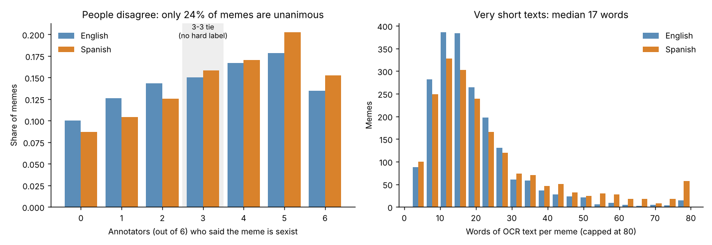
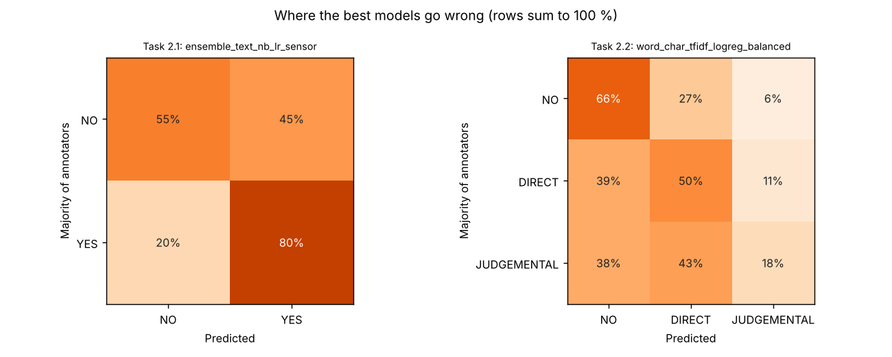

# Sexism detection in memes (EXIST 2026)


My solo entry to [EXIST 2026](https://nlp.uned.es/exist2026/), a shared task at the CLEF conference about detecting sexism in English and Spanish memes. Each meme comes with three questions: is it sexist, is the author being sexist or criticising sexism, and what kind of sexism is it. This year the organisers also recorded how people physically reacted while looking at each meme (eye-tracking, heart rate and EEG), which was the part I most wanted to try.

I did it for the NLP course (LNR) at UPV in spring 2026 and sent 9 runs in May. My best result was 43rd out of 185 runs in the categorisation task. Those runs are kept unchanged in [original_submission/](original_submission).



The data is harder than it looks. Each meme was labelled by six people, and they all agreed on only 24 % of them. The text comes from OCR, so it's short (half the memes have 17 words or fewer) and full of errors.

## What I changed afterwards

In May I picked my models with a single 80/20 split and never computed the official metric myself. When I came back to it in November, I wanted to know how good those models really were. So I:

- switched to 5-fold cross-validation, with separate English and Spanish models;
- computed the official ICM metric with the organisers' library, PyEvALL;
- tried class weights, which turned out to be the biggest improvement, because the rare classes stopped being ignored;
- trained subtask 2.1 on the share of votes instead of a yes/no label ("learning with disagreement").

| Macro-F1 | May 2026 | Now |
|---|---|---|
| 2.1 Is it sexist? | 0.654 | 0.676 |
| 2.2 Author's intention | 0.426 | 0.452 |
| 2.3 Type of sexism | 0.411 | 0.456 |

On the official metric, a small ensemble (Naive Bayes, logistic regression and a sensor model) is the most consistent across the three tasks. The full tables are in [docs/details.md](docs/details.md).

## What I learned

The physiological signals barely help. On their own they're close to chance, and added to the text they only help a little with the author's intention. My guess is that the body reacts to how striking a meme is, not to what kind of sexism it contains.



The hardest memes are the ones that criticise sexism by showing it. The models mostly mistake them for memes that are sexist themselves or not sexist at all, because telling "showing this to criticise it" apart from "saying it" needs irony and context that word counts can't capture.

In the course labs I also fine-tuned RoBERTa and tried prompting a small LLM (FLAN-T5) on the same data. RoBERTa scored about the same as TF-IDF in English, and the small LLM was weak. With text this short and noisy, a well-tuned classic model holds up surprisingly well. The next step would be a model that also looks at the image, such as CLIP.

## Running it

The dataset isn't included, because its licence doesn't allow it. You can request it from the [organisers](https://nlp.uned.es/exist2026/) and put the two JSON files in `data/`.

```bash
pip install -r requirements.txt
make experiments soft figures    # about 10 minutes on a laptop
make test

# PyEvALL needs an older numpy, so the official metric gets its own environment
python -m venv .venv-pyevall && .venv-pyevall/bin/pip install pyevall
make icm
```

How the labels, features and models work, and the repo layout, are in [docs/details.md](docs/details.md). The timeline is in [docs/project_history.md](docs/project_history.md).
