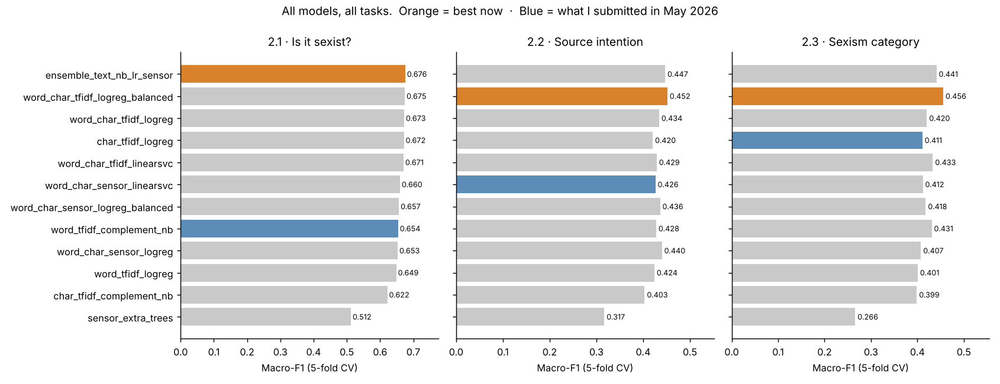
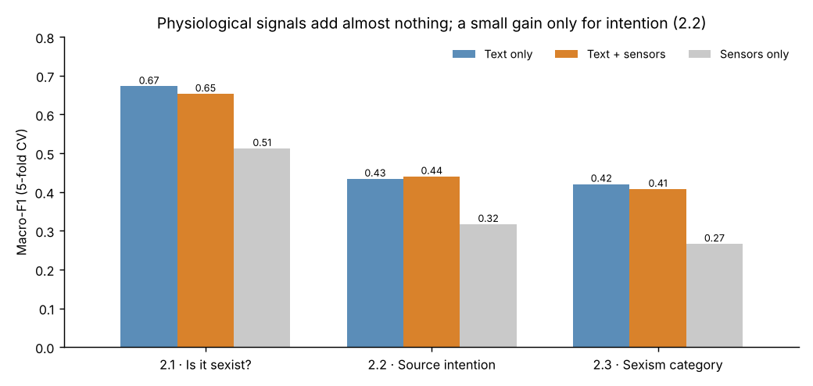
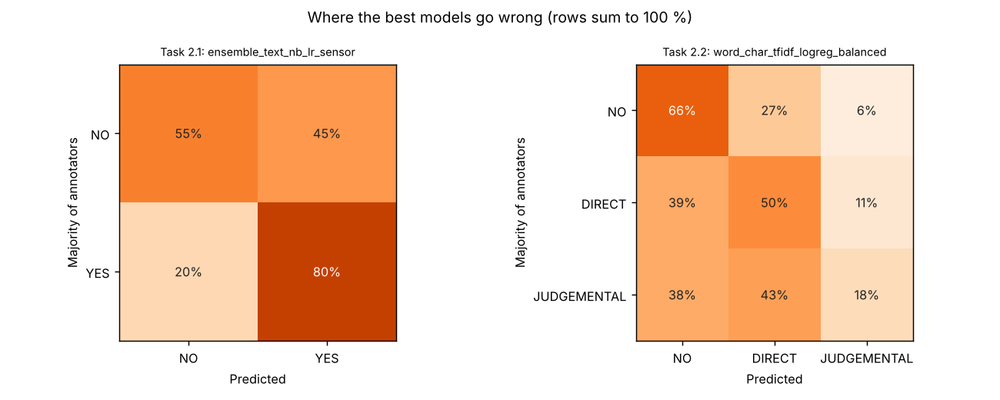

# Technical details

Full results, how the system works and what else I tried. The short version is in the [README](../README.md).

## Results

5-fold cross-validation, separate English and Spanish models. ICM-Norm is EXIST's official metric, computed with [PyEvALL](https://pypi.org/project/PyEvALL/); 0.5 means no information, higher is better.

| Task | Submitted in May 2026 | Macro-F1 | ICM-Norm | Best model now | Macro-F1 | ICM-Norm |
|---|---|---|---|---|---|---|
| 2.1 | Word TF-IDF + Naive Bayes | 0.654 | 0.478 | Ensemble (NB + LogReg + sensors) | 0.676 | 0.512 |
| 2.2 | Word+char TF-IDF + sensors + SVM | 0.426 | 0.313 | Word+char TF-IDF + LogReg, balanced | 0.452 | 0.334 |
| 2.3 | Char TF-IDF + LogReg | 0.411 | 0.312 | Word+char TF-IDF + LogReg, balanced | 0.456 | 0.296 |

- Every task improves on macro-F1: +2.1, +2.6 and +4.5 points. The biggest gain is from class balancing: rare classes (JUDGEMENTAL, SEXUAL-VIOLENCE) stop being ignored.
- The ensemble is the safest choice on the official metric. It beats the May 2026 model on ICM in all three tasks. Macro-F1 and ICM don't always agree, so both are reported.
- English is easier than Spanish (2.1: 0.70 vs 0.65; 2.2: 0.48 vs 0.42).



### Do the physiological signals help?


Barely. Sensors alone are close to chance. Added to text, they help only with intention (2.2), the one question about the author's attitude rather than the content, and they slightly hurt the others. My May 2026 analysis found the same pattern.

### Learning with disagreement (soft labels, 2.1)
Instead of YES/NO, predict how many people would call the meme sexist. Training on the vote shares themselves (each meme enters as YES and as NO, weighted by its votes) gives better-calibrated probabilities: cross-entropy 0.705 to 0.657, and closer to the real vote share (MAE 0.251 to 0.240). The official ICM-Soft barely changes (0.404 vs 0.399). The soft test run is `runs/task2_1_soft_Alejandro_1.json`.

### Where the models go wrong


JUDGEMENTAL memes (criticising sexism) are mostly read as DIRECT or NO. Telling reporting from endorsing takes irony and context that a bag of words can't see. That's where a multimodal or transformer model should help most.

## How it works

1. Labels. Strict majority (2.1: more than 3 of 6 votes; 2.2: more than 2; 2.3: categories chosen by more than 1). Ties are left out of hard training and evaluation. Code in [`src/data.py`](../src/data.py), unit-tested in [`tests/`](../tests)
2. Text. Word TF-IDF (1–2 grams) and character TF-IDF (3–5 grams). Character n-grams survive OCR noise and creative spelling.
3. Sensors. 108 measures (24 eye-tracking, 4 heart-rate, 80 EEG band powers), averaged over viewers, plus how much the viewers disagreed. That gives 217 features.
4. Models. 12 configurations: Naive Bayes, logistic regression, linear SVM, Extra Trees, with text, sensors or both, plus a soft-voting ensemble. Code in [`src/models.py`](../src/models.py)
5. Hierarchy. For 2.3, the best 2.1 model first decides whether the meme is sexist. Only sexist memes get categories, each at least its most likely one.
6. Runs. The top 3 configurations per task are retrained on all the data and predict the 1,053 test memes, plus one soft run. All runs are format-checked in CI. See [`runs/`](../runs).

## Also explored (course labs, same data)

| Notebook | What | Result |
|---|---|---|
| [`02_exploration_transformers_roberta_shap_lime`](../notebooks/02_exploration_transformers_roberta_shap_lime.ipynb) | Fine-tuned RoBERTa (EN) and a Spanish transformer for 2.1; explained predictions with SHAP and LIME (ferret-xai) | Macro-F1 ≈ 0.65 (EN), 0.57 (ES) on the dev split |
| [`03_exploration_llm_prompting_flan_t5`](../notebooks/03_exploration_llm_prompting_flan_t5.ipynb) | LLM prompting, zero-shot and few-shot in-context learning with FLAN-T5 | Weak on a 50-meme sample: a small LLM without fine-tuning is no match for a supervised model |

On this short, noisy text, tuned TF-IDF models matched fine-tuned transformers at a fraction of the cost. Next step: a model that also sees the image (e.g. CLIP).

## Repository structure

```
├── src/
│   ├── data.py               # load EXIST JSON, hard labels, sensor features
│   ├── models.py             # model zoo
│   ├── run_experiments.py    # cross-validation for 3 tasks + 9 hard runs
│   ├── soft_labels.py        # learning with disagreement (2.1) + soft run
│   ├── evaluate_pyevall.py   # official ICM / ICM-Soft on out-of-fold predictions
│   ├── eda.py · make_figures.py · error_analysis.py
│   └── validate_runs.py      # format check for every run (CI)
├── tests/                    # label rules and sensor features
├── notebooks/01_walkthrough.ipynb  # the whole story (runs without the dataset)
├── runs/                     # 10 test-set runs, PyEvALL format
├── original_submission/      # the 9 runs submitted in May 2026
├── results/                  # metrics, ICM scores, figures, out-of-fold predictions
├── docs/project_history.md
└── data/                     # put the EXIST files here (not redistributed)
```
